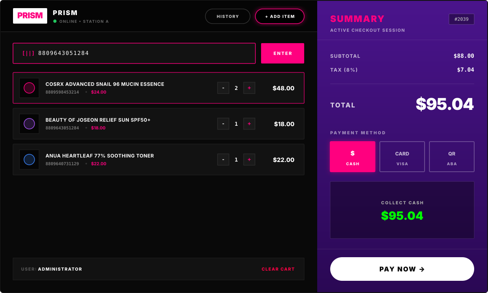
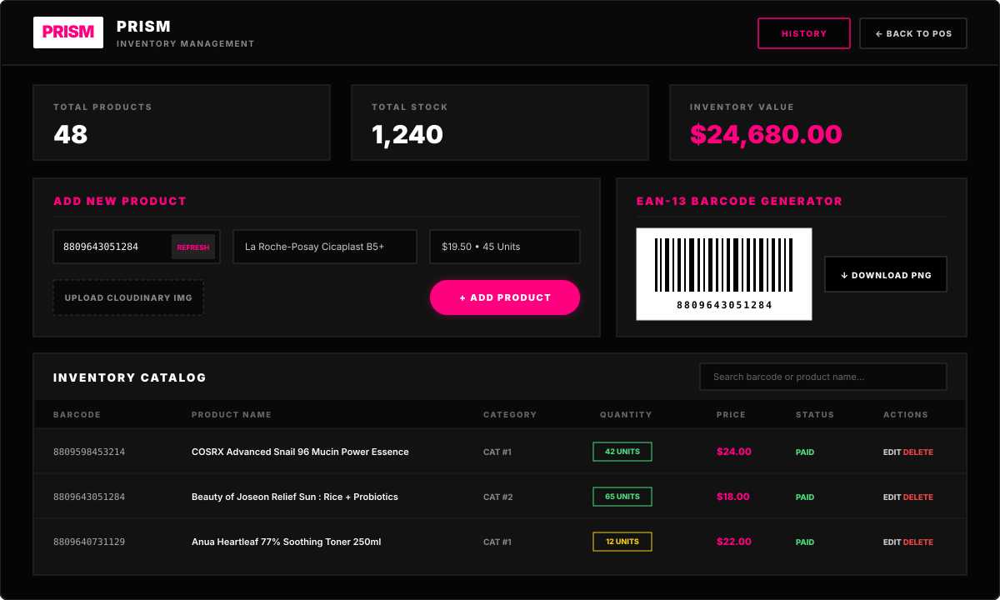
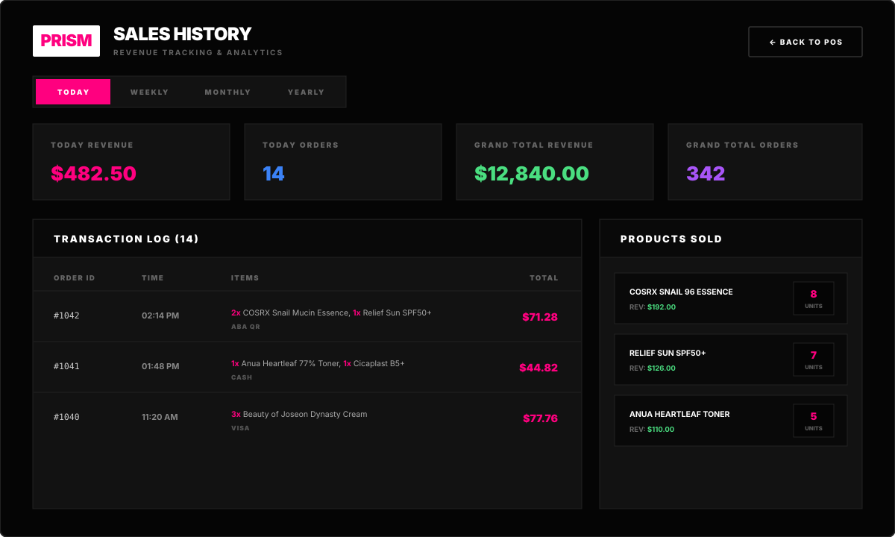
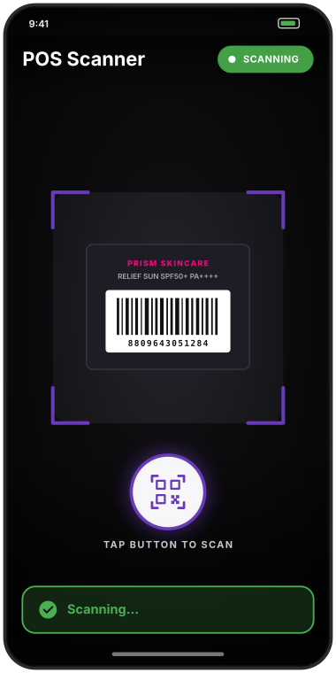

<div align="center">
  

  # Prism Pos system

  **A Point-of-Sale (POS) and Inventory Management System for a Skincare Store, integrated with a Mobile Camera Barcode Scanner for real-time checkout and stock management.**

  
  
  
  
  
</div>

---

## Overview

**Prism Pos system** is a full-stack Point-of-Sale (POS), inventory management, and revenue analytics platform built specifically for retail skincare stores. It combines a responsive web checkout terminal and admin dashboard with a companion **Flutter mobile barcode scanner app** that scans product barcodes via the phone camera and syncs items directly into the active checkout cart in real time.

---

## UI Display

### 1. POS Checkout Terminal
Real-time cart synced with the mobile scanner and manual barcode entry, supporting **Cash**, **Visa Card**, and **ABA QR** payments, automatic 8% tax calculation, and instant PDF receipt generation.



---

### 2. Inventory Management & EAN-13 Barcode Generator
Staff dashboard for adding, editing, and searching skincare products, uploading product photos via **Cloudinary**, monitoring stock levels and total inventory value, and generating downloadable **EAN-13 barcodes** (`PNG`).



---

### 3. Sales History & Revenue Analytics
Interactive transaction log and best-selling product breakdown filtered by **Today**, **Weekly**, **Monthly**, and **Yearly** performance metrics.



---

### 4. Mobile POS Barcode Scanner App (Flutter)
Companion mobile camera scanner app with a live viewfinder, one-tap barcode detection, audio/vibration feedback, and instant Wi-Fi synchronization with the web checkout cart.

<div align="center">
  
</div>

---

## What the Website Does

- **Live Point-of-Sale Checkout (`POSCartUI`):**
  - Scans 13-digit EAN barcodes manually or receives scanned items automatically from the companion mobile scanner app.
  - Adjusts item quantities (`+` / `-`), calculates subtotal and 8% tax, and supports **Cash**, **Visa**, and **ABA Mobile Banking QR** checkout flows.
  - Generates and previews downloadable **PDF receipts** (`PDFKit`) on checkout while automatically deducting product stock in MySQL.
- **Inventory & Product Dashboard (`Dashboard`):**
  - Protected behind **Staff Login** authentication.
  - Full CRUD management for skincare products (barcode, name, category, stock quantity, unit price, payment status, and Cloudinary image uploads).
  - Built-in **EAN-13 Barcode Generator** with automatic checksum calculation and one-click PNG barcode label download (`JsBarcode`).
- **Revenue & Sales Analytics (`History`):**
  - Tracks order history and revenue across daily, weekly, monthly, and yearly periods.
  - Aggregates top-selling skincare products by units sold and total revenue generated.
- **Mobile Camera Barcode Scanner (`pos_scanner`):**
  - Cross-platform Flutter mobile app using **Google ML Kit Barcode Scanning** with audio/vibration feedback to scan physical skincare product barcodes directly into the web POS cart over Wi-Fi.

---

## Tech Stack

| Layer | Technologies Used |
| :--- | :--- |
| **Frontend** | React 19, Vite, Tailwind CSS, Axios, JsBarcode, Lucide Icons |
| **Backend** | Node.js, Express 5, Multer, Cloudinary SDK, PDFKit |
| **Database** | MySQL (`mysql2`) |
| **Mobile Scanner** | Flutter (Dart), Camera, Google ML Kit Barcode Scanning, Audioplayers |

---

## Project Structure

```text
pos_skincare_sys/
├── backend/          # Node.js + Express REST API, PDF receipt generator, MySQL & Cloudinary integration
├── frontend/         # React + Vite + Tailwind CSS POS web application & admin dashboard
├── pos_scanner/      # Flutter mobile camera barcode scanner app
└── assets/           # UI preview graphics for documentation
```

---

## Getting Started

### 1. Backend Setup
```bash
cd backend
npm install
# Configure your .env file with DB_HOST, DB_USER, DB_PASSWORD, DB_NAME, and CLOUDINARY credentials
npm run dev
```

### 2. Frontend Setup
```bash
cd frontend
npm install
npm run dev
```

### 3. Mobile Barcode Scanner Setup (Optional)
```bash
cd pos_scanner
flutter pub get
flutter run
```

